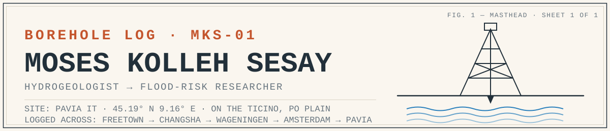
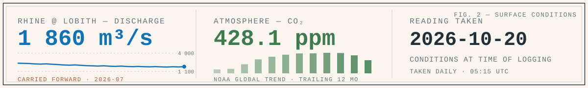
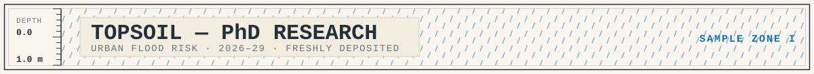
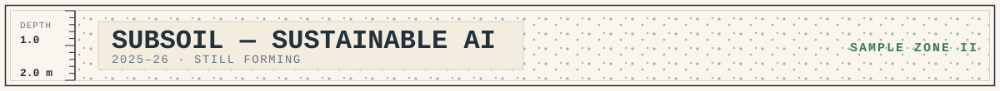
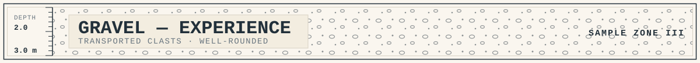
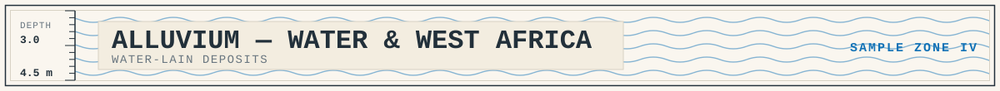
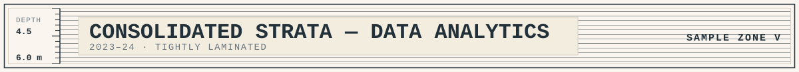
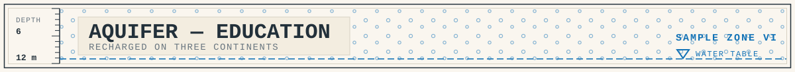
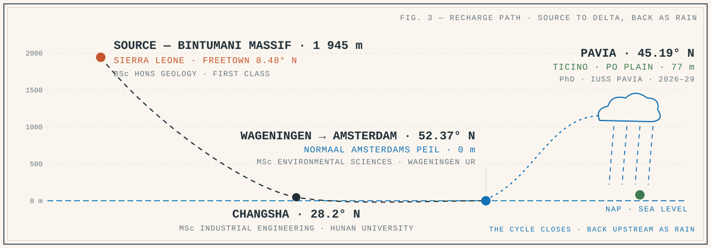
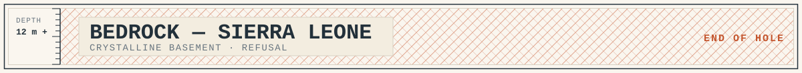

<picture>
  <source media="(prefers-color-scheme: dark)" srcset="assets/header-dark.svg">
  
</picture>

| | |
|---|---|
| **LOGGED BY** | Moses Kolleh Sesay — hydrogeologist → flood-risk researcher · Pavia, IT |
| **RESEARCH** | [ORCID 0009-0002-9429-1672](https://orcid.org/0009-0002-9429-1672) · [PhD summary](https://moseskolleh.github.io/research.html#phd) · [Research outputs](https://moseskolleh.github.io/research.html) |
| **CONTACT** | [moseskollehsesay@gmail.com](mailto:moseskollehsesay@gmail.com) · [LinkedIn](https://www.linkedin.com/in/moseskollehsesay) · [@MosesKolleh](https://x.com/MosesKolleh) · [Website](https://moseskolleh.github.io/) · [CV (PDF)](https://moseskolleh.github.io/assets/Moses_Kolleh_Sesay_CV.pdf) |
| **KEY SAMPLES** | [promptcoach](https://github.com/moseskolleh/promptcoach) · [GAIA-Framework](https://github.com/moseskolleh/GAIA-Framework-) · [Maji](https://github.com/moseskolleh/Maji) |
| **METHOD** | Python · SQL · R · GIS (QGIS, ArcGIS, Google Earth Engine) · TypeScript |
| **STATUS** | PhD researcher at IUSS Pavia from November 2026 · open to research collaborations on climate and flood risk, water and ESG |

> I read landscapes for a living — first with a rock hammer and a dip meter in Sierra Leone, then with pandas and Google Earth Engine in the Netherlands, and now with rainfall records and drainage networks in Northern Italy. A core log records what a place is made of, newest layer first. This is mine. **Drill down.**

`● recording (active)` · `◍ field-validated` · `◌ prototype` · `▣ archived survey`

## Daily readings — the Rhine, Monza's rain and the atmosphere

<picture>
  <source media="(prefers-color-scheme: dark)" srcset="assets/surface-conditions-dark.svg">
  
</picture>

> *Three numbers I watch the way other people watch the weather: how much water the Rhine is carrying as it enters the Netherlands (measured at Lobith, the gauge the whole country checks first), how much rain has fallen on Monza over the last 30 days (from ARPA Lombardia's gauge in the province my PhD studies), and how much CO₂ is in the air. A script logs them here every morning — and because a hydrologist never trusts an undated reading, the panel always shows the date it was taken, and marks any value it could not refresh with the day it was last measured. [How this works →](scripts/update_surface_conditions.py)*

<picture>
  <source media="(prefers-color-scheme: dark)" srcset="assets/stratum-1-dark.svg">
  
</picture>

## Now — TOPSOIL · 2026–29 · urban flood risk

The newest layer, freshly deposited. From November 2026 I am a doctoral researcher in Pavia, working on one question:

> **How will a changing climate alter the odds of extreme rainfall, and what will that mean for urban drainage and for the losses floods cause?**

- ● **PhD Researcher — Climate-Driven Urban Flood Risk** · Scuola Universitaria Superiore IUSS Pavia · `Nov 2026 – present`

  PhD in Sustainable Development and Climate Change, Curriculum Beta (human society: socio-economic impacts, policies and institutions). The study area is the Province of Monza and Brianza, a highly urbanised part of Lombardy exposed to pluvial flooding. `SAMPLE PV-26 · urban flood risk · climate projections · socio-economic impacts · SDG 6 · 9 · 11`

  Nothing to report yet: no results, no model and no data. [The full summary, and what it does not claim →](https://moseskolleh.github.io/research.html#phd)

<picture>
  <source media="(prefers-color-scheme: dark)" srcset="assets/stratum-2-dark.svg">
  
</picture>

## Sustainable AI — SUBSOIL · 2025–26 · still forming

Still forming beneath the new topsoil. I build tools that make AI's water and energy costs visible before you spend them. [Case study →](https://moseskolleh.github.io/case-studies.html#sustainable-ai)

- ● **[promptcoach](https://github.com/moseskolleh/promptcoach)** — Shows an AI prompt's energy, water, and carbon cost in units you can feel — *"2 teaspoons of water"* — before you hit send, then coaches you to shrink it. Every formula and source is cited in its [methodology](https://github.com/moseskolleh/promptcoach/blob/main/docs/METHODOLOGY.md). `SAMPLE PC-77 · Chrome MV3 · tested core engine · 19-model catalog`

- ● **[GAIA-Framework](https://github.com/moseskolleh/GAIA-Framework-)** — A dashboard that grades 18+ AI models from A+ to F on energy, water, and carbon so teams can choose greener deployments. `SAMPLE GA-60 · vanilla JS · zero dependencies · CSV export`

- ◍ **[SustainableAIPrototypes](https://github.com/moseskolleh/SustainableAIPrototypes)** — Five behaviour-change prototypes, built at the Digital Society School with a Dutch government partner, that turn invisible AI carbon into feedback people act on. The repo carries the partner feedback and research alongside the code. `SAMPLE SP-33 · partner-validated fieldwork`

<picture>
  <source media="(prefers-color-scheme: dark)" srcset="assets/stratum-3-dark.svg">
  
</picture>

## Experience — GRAVEL · transported, well-rounded

Material carried in from elsewhere and worn smooth by use: from drilling crews in Sierra Leone to disaster-loss data at the UN, the groundwork the PhD now stands on.

- ▣ **Researcher — Sustainable Artificial Intelligence** · Digital Society School, Amsterdam University of Applied Sciences · `Sept 2025 – Feb 2026`

  Researched sustainable AI in a team, with a Dutch government partner; the prototypes above came out of it.

- ▣ **Cohort 7 Member — Sustainability Consulting Accelerator** · OnePointFive · `Mar – Apr 2025`

  Intensive eight-week programme on Net Zero strategy and decarbonisation: SBTi, CDP and the GHG Protocol; materiality assessments, Scope 1–3 accounting and transition planning.

- ▣ **Climate Change Adaptation Intern** · UN Office for Disaster Risk Reduction (UNDRR), Bonn · `Jun – Oct 2023`

  Reviewed disaster-loss data for Caribbean countries feeding the Sendai Framework Monitor, documented 54 global hazard information systems for the organisation's catalogue, and wrote a disaster and climate-risk factsheet for Trinidad and Tobago. [Case study →](https://moseskolleh.github.io/case-studies.html#un-disaster)

- ▣ **Field Operations Manager** · Team & Team International, Freetown · `May – Sept 2019`

  Led completion of 14 solar-powered boreholes with storage tanks across Sierra Leone, sited by electrical-resistivity survey: 70% of those drilled struck water. [How the sites were chosen →](https://moseskolleh.github.io/case-studies.html#groundwater)

- ▣ **Operations Supervisor** · Sierra Drilling and Water Supply Enterprise, Freetown · `Sept 2018 – Apr 2019`

  Managed a drilling team of 23 that constructed 50 boreholes and rehabilitated 100 hand-dug wells.

<picture>
  <source media="(prefers-color-scheme: dark)" srcset="assets/stratum-4-dark.svg">
  
</picture>

## Water & West Africa — ALLUVIUM · water-lain

Everything I build eventually finds its way back to water. *Maji* is Swahili for it.

- ◌ **[Maji](https://github.com/moseskolleh/Maji)** — A mobile-first, offline-capable platform for Freetown's informal water economy: crowdsourced supply alerts from paid Water Scouts, a vendor marketplace on Orange Money and Africell mobile money, and a live PostGIS water-point map. Offline-first, because the network fails exactly when the taps do. The problem I grew up next to, built with the stack I have now. `SAMPLE MJ-07 · TypeScript · Fastify + PostGIS + Prisma · React Native · early-stage`

- ▣ **[Coastal water pollution dynamics](https://moseskolleh.github.io/case-studies.html#coastal)** — My MSc thesis at Wageningen: river export of multiple pollutants across 10,226 sub-basins worldwide, analysed with the MARINA-Multi model of Wageningen's Water Systems & Global Change group; the socioeconomic drivers identified statistically; and scenario storylines for Africa's coastal waters under climate change. `SAMPLE WU-24 · thesis on request`

- ◌ **[climatematchProjects](https://github.com/moseskolleh/climatematchProjects)** — A five-proposal research program design (€2.6M scope) for African climate resilience: drought early warning, hybrid physics-ML flood prediction, and coastal compound risk. `SAMPLE CM-14 · research design`

<picture>
  <source media="(prefers-color-scheme: dark)" srcset="assets/stratum-5-dark.svg">
  
</picture>

## Data analytics — CONSOLIDATED STRATA · 2023–24

The layer everything above stands on: statistics done carefully enough to say no.

- ▣ **[A/B Testing at GloBox](https://github.com/moseskolleh/A-B-Testing-at-Globox)** — SQL → Python statistics → Tableau, ending in the rarest analyst deliverable: a well-argued recommendation *not* to ship a feature that lifted conversion but not revenue. Novelty effects said wait. `SAMPLE GB-38 · full report + Tableau dashboard`

- Google Advanced Data Analytics (Google · Coursera, Jan 2024) — regression and machine learning on real business cases (Automatidata, TikTok, Waze). Data Analytics Training (Masterschool, Dec 2023) — SQL, Python, Excel and Tableau on real-world business cases.

<picture>
  <source media="(prefers-color-scheme: dark)" srcset="assets/stratum-6-dark.svg">
  
</picture>

## Education — AQUIFER · recharged on three continents

An aquifer stores what the surface forgets. Mine was recharged in Freetown, Changsha and Wageningen — and, from November 2026, Pavia.

| Years | Degree | Institution |
|---|---|---|
| 2026–2029 | PhD in Sustainable Development and Climate Change *(in progress)* | Scuola Universitaria Superiore IUSS Pavia, IT |
| 2021–2024 | MSc Environmental Sciences — Human-Environment Interaction · Water Systems & Global Change | Wageningen University & Research, NL |
| 2019–2021 | MSc Industrial Engineering | Hunan University, CN |
| 2013–2017 | BSc Honours Geology, First Class Honours | University of Sierra Leone, SL |

Also certified: ESG Specialist Program (Corporate Finance Institute, Sep 2024) · Synergizing DRR & Climate Change Adaptation (UN System Staff College, 2023).

<picture>
  <source media="(prefers-color-scheme: dark)" srcset="assets/drill-path-dark.svg">
  
</picture>

<picture>
  <source media="(prefers-color-scheme: dark)" srcset="assets/stratum-7-dark.svg">
  
</picture>

## Bedrock — SIERRA LEONE

> Basement rock: Freetown, Sierra Leone — where I first learned that water is never abstract. It's about who can reach it, and when. Everything above sits on this. If you're working on climate, water, flood risk, or the places data usually skips, my inbox is open.

---

`END OF LOG · TOTAL DEPTH: ONE CAREER, STILL DRILLING`

[moseskollehsesay@gmail.com](mailto:moseskollehsesay@gmail.com) · [ORCID](https://orcid.org/0009-0002-9429-1672) · [LinkedIn](https://www.linkedin.com/in/moseskollehsesay) · [Website](https://moseskolleh.github.io/)

