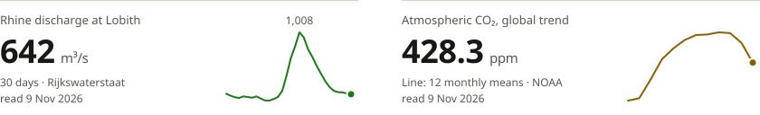

<picture>
  <source media="(prefers-color-scheme: dark)" srcset="assets/banner-dark.svg">
  
</picture>

I study how a changing climate will change extreme rainfall, and what that will mean for urban drainage and for the losses that floods cause. Since November 2026 I have been working on that question as a PhD researcher at IUSS Pavia, with the Province of Monza and Brianza in Lombardy as my study area. The banner above is redrawn every morning from the rain gauge there.

I came to this question from the ground up. I trained as a geologist in Sierra Leone and began my career siting and drilling boreholes there, where I learned that water is never abstract: it is about who can reach it, and when. Reviewing disaster-loss data at the UN Office for Disaster Risk Reduction, and then analysing river pollution across more than ten thousand sub-basins at Wageningen, taught me to ask the same question at the scale of countries and river basins. The PhD brings those threads together in one city-region.

[Website](https://moseskolleh.github.io/) · [Research](https://moseskolleh.github.io/research.html) · [CV (PDF)](https://moseskolleh.github.io/assets/Moses_Kolleh_Sesay_CV.pdf) · [ORCID](https://orcid.org/0009-0002-9429-1672) · [LinkedIn](https://www.linkedin.com/in/moseskollehsesay) · [X](https://x.com/MosesKolleh) · [Email](mailto:moseskollehsesay@gmail.com)

## Daily readings

<picture>
  <source media="(prefers-color-scheme: dark)" srcset="assets/readings-dark.svg">
  
</picture>

<!-- readings:start -->
Read on 14 Nov 2026: **102 mm** of rain at Monza over 30 days · the Rhine at Lobith carrying **659 m³/s** · the global CO₂ trend at **428.3 ppm**.
<!-- readings:end -->

Three numbers I watch the way other people watch the weather: the rain falling on the province I study, the water the Rhine carries as it enters the Netherlands, and the CO₂ in the air. A [short script](scripts/update_readings.py) reads them each morning from ARPA Lombardia, Rijkswaterstaat and NOAA. Every value carries the date it was actually read, so when a source is down you see an older date rather than a number that only looks fresh.

## Research

**Climate-driven urban flood risk** · PhD in Sustainable Development and Climate Change, IUSS Pavia · 2026–2029

The study area is the Province of Monza and Brianza, a highly urbanised part of Lombardy exposed to pluvial flooding. I am enrolled in Curriculum Beta, which looks at the human side of climate change: socio-economic impacts, policies and institutions.

The work has only just begun, so I have no results, no model and no data to show yet. The [research summary](https://moseskolleh.github.io/research.html#phd) sets out the project and is explicit about what it does not claim.

Before the PhD, my MSc thesis at Wageningen studied [coastal water pollution](https://moseskolleh.github.io/case-studies.html#coastal): river export of multiple pollutants across 10,226 sub-basins worldwide with the MARINA-Multi model, the socio-economic drivers behind it, and scenario storylines for Africa's coastal waters under climate change. The thesis is available on request.

## Selected work

**Making the footprint of AI visible.** In 2025–26 I researched sustainable AI at the Digital Society School in Amsterdam, and built tools that show AI's water and energy costs before you spend them. [Case study](https://moseskolleh.github.io/case-studies.html#sustainable-ai)

- **[promptcoach](https://github.com/moseskolleh/promptcoach)** shows the energy, water and carbon cost of an AI prompt in units you can feel, such as "2 teaspoons of water", before you send it, and then coaches you to shrink it. A Chrome extension with a tested core engine; every formula and source is cited in its [methodology](https://github.com/moseskolleh/promptcoach/blob/main/docs/METHODOLOGY.md).
- **[GAIA-Framework](https://github.com/moseskolleh/GAIA-Framework-)** grades 18+ AI models from A+ to F on energy, water and carbon, so that teams can choose greener deployments.
- **[SustainableAIPrototypes](https://github.com/moseskolleh/SustainableAIPrototypes)** holds five behaviour-change prototypes built with a Dutch government partner, published together with the partner's feedback and the research behind them.

**Water, where I started.**

- **[Maji](https://github.com/moseskolleh/Maji)** is an early-stage platform for Freetown's informal water economy: supply alerts from paid Water Scouts, a vendor marketplace on mobile money and a live map of water points. It is built offline-first, because the network fails exactly when the taps do. *Maji* is Swahili for water.
- **[climatematchProjects](https://github.com/moseskolleh/climatematchProjects)** is a research design of five proposals for African climate resilience, covering drought early warning, hybrid physics-ML flood prediction and coastal compound risk.

**Statistics careful enough to say no.**

- **[A/B Testing at GloBox](https://github.com/moseskolleh/A-B-Testing-at-Globox)** runs from SQL through Python statistics to a Tableau dashboard, and ends in a recommendation *not* to ship a feature that lifted conversion but not revenue.

## Path

- **2026–29 · Pavia.** PhD in Sustainable Development and Climate Change, IUSS Pavia.
- **2025–26 · Amsterdam.** Researcher in sustainable AI, Digital Society School.
- **2021–24 · Wageningen.** MSc Environmental Sciences, with an internship at UNDRR in Bonn.
- **2019–21 · Changsha.** MSc Industrial Engineering, Hunan University.
- **2013–19 · Freetown.** BSc Geology with First Class Honours, then a year supervising borehole drilling across Sierra Leone.

<b>Experience and education in full</b>

 

**Experience**

- **PhD Researcher, Climate-Driven Urban Flood Risk** · Scuola Universitaria Superiore IUSS Pavia · Nov 2026 – present
- **Researcher, Sustainable Artificial Intelligence** · Digital Society School, Amsterdam University of Applied Sciences · Sept 2025 – Feb 2026 Researched sustainable AI in a team, with a Dutch government partner. The prototypes above came out of it.
- **Cohort 7 Member, Sustainability Consulting Accelerator** · OnePointFive · Mar – Apr 2025 An intensive eight-week programme on Net Zero strategy and decarbonisation: SBTi, CDP and the GHG Protocol, materiality assessments, Scope 1–3 accounting and transition planning.
- **Climate Change Adaptation Intern** · UN Office for Disaster Risk Reduction (UNDRR), Bonn · Jun – Oct 2023 Reviewed disaster-loss data for Caribbean countries feeding the Sendai Framework Monitor, documented 54 global hazard information systems for the organisation's catalogue, and wrote a disaster and climate-risk factsheet for Trinidad and Tobago. [Case study](https://moseskolleh.github.io/case-studies.html#un-disaster)
- **Field Operations Manager** · Team & Team International, Freetown · May – Sept 2019 Led the completion of 14 solar-powered boreholes with storage tanks across Sierra Leone, sited by electrical-resistivity survey. 70% of those drilled struck water. [How the sites were chosen](https://moseskolleh.github.io/case-studies.html#groundwater)
- **Operations Supervisor** · Sierra Drilling and Water Supply Enterprise, Freetown · Sept 2018 – Apr 2019 Managed a drilling team of 23 that constructed 50 boreholes and rehabilitated 100 hand-dug wells.

**Education**

| Years | Degree | Institution |
|---|---|---|
| 2026–2029 | PhD in Sustainable Development and Climate Change *(in progress)* | Scuola Universitaria Superiore IUSS Pavia, IT |
| 2021–2024 | MSc Environmental Sciences · Human-Environment Interaction · Water Systems & Global Change | Wageningen University & Research, NL |
| 2019–2021 | MSc Industrial Engineering | Hunan University, CN |
| 2013–2017 | BSc Honours Geology, First Class Honours | University of Sierra Leone, SL |

**Training**

- ESG Specialist Program · Corporate Finance Institute · Sep 2024
- Google Advanced Data Analytics · Google, Coursera · Jan 2024
- Data Analytics Training · Masterschool · Dec 2023
- Synergizing DRR & Climate Change Adaptation · UN System Staff College · 2023

**Tools**

Python · SQL · R · GIS (QGIS, ArcGIS, Google Earth Engine) · TypeScript

## Get in touch

I am open to research collaborations on climate and flood risk, water and ESG. If you are working on any of these, or on the places that data usually skips, I would be glad to hear from you: [moseskollehsesay@gmail.com](mailto:moseskollehsesay@gmail.com).
